# 🔬 Control Glass (`control-glass`)

> **High-Trust Agentic Engineering Harness** — เปลี่ยนกระบวนการทำงานร่วมกับ AI Agent จาก *"สายพานโรงงานที่ผลิตโค้ดขยะ (Slop Factory)"* สู่ **"ครัวมิชลิน (Michelin Kitchen)"** ที่ตรวจสอบได้ด้วยหลักฐานเชิงประจักษ์ และทลายคอขวดการตรวจโค้ด (Code Review Bottleneck) อย่างเป็นระบบ

---

## 🎯 ทำไมต้องมี Control Glass? (The Problem We Solve)

เมื่อทีมพัฒนาใช้ AI Agent ช่วยเขียนโค้ด ความเร็วในการสร้างโค้ดจะเพิ่มขึ้นอย่างก้าวกระโดด แต่สิ่งที่เกิดขึ้นตามมาคือ:
1. **Babysitting Trap (กับดักการนั่งเฝ้า AI):** หากปล่อยให้ AI ทำงานโดยไม่มีกรอบควบคุม AI มักจะใช้ทางลัด แปะผ้าปิดแผล (Workarounds) และคัดลอกรูปแบบโค้ดแย่ๆ ไปทั่วโปรเจกต์
2. **Review Overload (คอขวดย้ายไปที่การตรวจโค้ด):** งานเขียนโค้ดเสร็จเร็วขึ้น แต่เวลารอตรวจ Pull Request (Code Review) กลับช้าลงกว่า **400%** และเกิดบั๊กหลุดเข้า Production เพิ่มขึ้น **2–3 เท่า**
3. **Closed-Loop Testing Error (AI โกงข้อสอบตัวเอง):** หากสั่งให้ AI เขียนทั้งโค้ดและ Unit Test พร้อมกัน AI มักจะแอบแก้ Test ให้ผ่านตามโค้ดที่ผิดของตัวเอง

**`control-glass`** จึงถูกออกแบบมาโดยผสาน 2 แนวคิดระดับโลกเข้าด้วยกัน:
* 🍳 **"Michelin Kitchen" & Dune Architecture** *(จากบทเรียนการส่งมอบ 2,000 PRs/เดือน ของทีม Grokbot / SpaceX AI)* — ทำให้ *"ทางลัดที่ง่ายที่สุด คือทางที่ถูกต้องเสมอ" (Make the easy path the right path)*
* 🚦 **"The Bottleneck Moved" 3-Phase Framework** *(Context & Contracts -> Layered Guardrails -> Tiered Review Orchestration)* — ลดปริมาณงานที่ต้องใช้คนตรวจ ด้วยการคัดกรองความเสี่ยงอัตโนมัติ

---

## 🏗️ สถาปัตยกรรมและการทำงาน 3 ระยะ (Architecture Overview)

```mermaid
flowchart LR
    subgraph Phase1["Phase 1: Context & Contracts (ก่อนเขียนโค้ด)"]
        A1["AGENTS.md (สัญญากระชับ)"]
        A2["feature-map.json (ความจำถาวร)"]
        A3["Branded Types (ป้องกันส่งค่าผิดหน่วย)"]
        A4["TDD SHA-256 Lock (ห้าม AI แอบแก้ Test)"]
    end

    subgraph Phase2["Phase 2: Dune & Guardrails (ระหว่างเขียนโค้ด)"]
        B1["Strict TypeScript (Level 1 Control)"]
        B2["Dune AST Linter (ห้าม Comment / ล็อก Boundary)"]
        B3["Safety & Secret Gate (ดัก API Key / คำสั่งอันตราย)"]
    end

    subgraph Phase3["Phase 3: Control Glass & Orchestration (หลังเขียนโค้ด)"]
        C1["Control Glass CLI (เก็บหลักฐาน Empirical Evidence)"]
        C2["Diff & Consequence Analyzer"]
        C3["Tiered Review Router (Tier 0 / Tier 1 / Tier 2)"]
    end

    Phase1 --> Phase2 --> Phase3
```



---

## 🛡️ 6 ด่านตรวจสอบหลักของ Control Glass

ทุกครั้งที่รันคำสั่ง `npm run verify` ระบบจะตรวจสอบโค้ดผ่าน 6 ด่านอัตโนมัติ:

| ลำดับ | ด่านตรวจสอบ (Gate) | หน้าที่และสิ่งที่ป้องกัน |
| :---: | :--- | :--- |
| **1** | **Strict TypeScript & Branded Contracts** | บังคับใช้ **Branded Types** (เช่น `NewtonSeconds`, `PoundForceSeconds`, `Satang`, `PercentageInt`) และ `Result<T, E>` ป้องกันการส่งตัวเลขผิดหน่วยข้ามโมดูล (กรณีศึกษา *Mars Climate Orbiter*) |
| **2** | **Dune Custom AST Linter** | วิเคราะห์โครงสร้างโค้ดระดับ AST:<br>• **ห้ามใส่ Comment (`DUNE_NO_COMMENTS`):** ป้องกัน AI ใช้คอมเมนต์เป็นข้ออ้างในการเขียนโค้ดมักง่าย<br>• **ล็อกขอบเขตสถาปัตยกรรม (`DUNE_BOUNDARY_VIOLATION`):** ห้ามฝั่ง UI (`src/ui/`) import โมดูลระดับล่างหรือ Node I/O (`fs`, `child_process`)<br>• **ห้ามใช้ `any` / `as unknown` / `console.*`** |
| **3** | **Safety & Secret Gate** | สแกนหา API Keys / Private Keys ที่รั่วไหลในโค้ด และบล็อกคำสั่งอันตราย (`DROP TABLE`, `TRUNCATE TABLE`, `rm -rf`, `eval`) ตามหลัก **Least Privilege** |
| **4** | **TDD & Contract Immutability Lock** | ตรวจสอบค่า Hash (SHA-256) ของไฟล์ `tests/*.spec.ts` และ `src/core/contracts.ts` เทียบกับ `.control-glass/tdd-lock.json` **ป้องกันไม่ให้ AI แอบแก้ไฟล์เทสต์เพื่อให้โค้ดตัวเองผ่าน** |
| **5** | **Empirical Unit & Contract Tests** | รันชุดทดสอบทั้งหมดผ่าน Vitest เพื่อยืนยันความถูกต้องของ Logic (รวมถึงการป้องกันธุรกรรมซ้ำแบบ *Knight Capital* และ Canary Gate แบบ *CrowdStrike*) |
| **6** | **Tiered Review Orchestrator** | วิเคราะห์ `git diff` เทียบกับ `feature-map.json` เพื่อจัดระดับความเสี่ยงของงาน (**Tier 0, Tier 1, Tier 2**) และสร้างไฟล์หลักฐาน `.control-glass/evidence-latest.json` |

---

## 🚦 ระบบคัดแยกการรีวิวตามความเสี่ยง (Tiered Review Workflow)

เพื่อแก้ปัญหาคอขวดที่มนุษย์ต้องตรวจทุก PR ระบบจะจำแนกงานออกเป็น 3 ระดับโดยอัตโนมัติ:

* 🟢 **Tier 0 (Auto-Merge Eligible):** งานความเสี่ยงต่ำ เช่น การแก้ไขเฉพาะชั้นการแสดงผล (`src/ui/`) ที่ไม่กระทบ Contract และผ่านด่าน Control Glass 100% -> **สามารถตั้งค่าให้ผ่านอัตโนมัติโดยไม่ต้องรอมนุษย์รีวิว**
* 🟡 **Tier 1 (Task Owner Review):** งานพัฒนาฟีเจอร์ทั่วไป (เช่น `src/features/rollout/`) -> ส่งรายงานสรุปผลกระทบ (Diff & Consequence Report) ให้เจ้าของงานตรวจอย่างรวดเร็ว
* 🔴 **Tier 2 (Senior / Domain Expert Review):** งานความเสี่ยงสูงที่แตะ Core Contracts (`src/core/contracts.ts`), ระบบการเงิน (`settlement.ts`), ระบบคำนวณวิกฤต (`impulse-calculator.ts`), หรือตัว Harness (`src/harness/`) -> **บังคับให้ Senior Engineer เป็นผู้ตรวจสอบ**

---

## 📂 โครงสร้างโปรเจกต์ (Project Structure)

```text
control-glass/
├── AGENTS.md                        # สัญญาหลักฉบับกระชับสำหรับสั่งการ AI Agent
├── feature-map.json                 # Materialized Memory (แผนผังฟีเจอร์, ขอบเขต Import, และระดับ Tier)
├── .control-glass/
│   ├── tdd-lock.json                # รายการล็อก SHA-256 ของไฟล์ Test และ Contract
│   └── evidence-latest.json         # หลักฐานผลการตรวจสอบล่าสุดจาก Control Glass CLI
├── .agent/
│   ├── rules/                       # กฎบังคับใช้กับ AI Agent อัตโนมัติใน Workspace
│   └── skills/                      # Playbooks (PAC Workflow, Control Glass, Gardener, Diff Reviewer)
├── src/
│   ├── core/
│   │   └── contracts.ts             # Branded Types, Result Monad และ Interface Contracts
│   ├── features/                    # โดเมนฟีเจอร์ตามโครงสร้าง Single Paved Path
│   │   ├── thruster/                # ตัวอย่างป้องกันบั๊กหน่วยวัด (Mars Climate Orbiter Safeguard)
│   │   ├── ledger/                  # ตัวอย่างระบบการเงินและ Idempotency (Knight Capital Safeguard)
│   │   └── rollout/                 # ตัวอย่างระบบ Canary Deployment 1%->10%->100% (CrowdStrike Safeguard)
│   ├── ui/
│   │   └── telemetry-view.ts        # ชั้นแสดงผล (Renderer-safe, Tier 0)
│   └── harness/                     # เครื่องมือแกนหลักของ Control Glass
│       ├── control-glass.ts         # Verification Pipeline CLI หลัก
│       ├── dune-linter.ts           # ตัวตรวจจับ AST (No-Comment, Boundary Lock, No-Any)
│       ├── tdd-guard.ts             # ระบบล็อกไฟล์ Test ป้องกัน Closed-Loop Testing Error
│       ├── safety-gate.ts           # ด่านตรวจจับ Secret Leak และคำสั่งอันตราย
│       └── diff-reviewer.ts         # ตัววิเคราะห์ Git Diff และจัดระดับ Tier 0 / 1 / 2
└── tests/                           # ชุดทดสอบที่ถูกล็อกด้วย SHA-256
```

---

## 🚀 เริ่มต้นใช้งานอย่างรวดเร็ว (Quick Start)

### 1. ติดตั้งแพ็กเกจ (Installation)
ต้องมี **Node.js v20+** และ **Git** ติดตั้งอยู่ในเครื่อง:

```bash
git clone https://github.com/Sakeerin/control-glass.git
cd control-glass
npm install
```

### 2. รันระบบตรวจสอบ Control Glass ครบวงจร
```bash
npm run verify
```
หากทุกอย่างถูกต้อง คุณจะเห็นผลลัพธ์ดังนี้:
```text
🔬 [Control Glass] Starting Empirical Verification Pipeline...

  1. [Level 1] Strict TypeScript Compiler: ✅ PASS
  2. [Level 2] Dune AST Linter (10 files): ✅ PASS
  3. [Phase 2] Safety & Secret Gate (15 files): ✅ PASS
  4. [Phase 1] TDD & Contract Immutability Lock: ✅ PASS
  5. [Level 1] Empirical Contract & Unit Tests: ✅ PASS
  6. [Phase 3] Tiered Review Routing: 🎯 Tier 0 — AUTO-MERGE ELIGIBLE

🏆 Control Glass Verification SUCCEEDED. High-trust quality verified!
```

---

## 🛠️ คำสั่ง CLI ทั้งหมด (Available Commands)

| คำสั่ง | คำอธิบาย |
| :--- | :--- |
| `npm run verify` | **คำสั่งหลัก:** รันทุกด่านตรวจสอบพร้อมกัน และสร้างไฟล์หลักฐาน `.control-glass/evidence-latest.json` |
| `npm run typecheck` | ตรวจสอบชนิดข้อมูลด้วย Strict TypeScript Compiler |
| `npm run lint:dune` | รัน Dune AST Linter ตรวจจับ Comment, การแหกกฎ Boundary Import, และการใช้ `any` |
| `npm run guard:safety` | สแกนหา API Keys/Secrets รั่วไหล และคำสั่งอันตรายในโค้ด |
| `npm run guard:tdd` | ตรวจสอบว่าไฟล์ Test และ Contract ไม่ถูกแอบแก้ไขระหว่างที่ AI เขียนโค้ด |
| `npm run lock:tests` | อัปเดตค่า SHA-256 Lock ใน `.control-glass/tdd-lock.json` *(ใช้เฉพาะใน Phase 1 ตอนตกลงสเปก/เขียน Test เสร็จใหม่ๆ)* |
| `npm test` | รันชุดทดสอบ Unit & Contract Tests ด้วย Vitest |
| `npm run review:diff` | วิเคราะห์ไฟล์ที่เปลี่ยนแปลงใน Git เทียบกับ `feature-map.json` เพื่อประเมินว่าต้องใช้คนรีวิวระดับใด (`Tier 0 / 1 / 2`) |

---

## 👨‍💻 ขั้นตอนการพัฒนาฟีเจอร์ใหม่ร่วมกับ AI Agent (PAC Workflow)

เมื่อคุณต้องการนำโปรเจกต์นี้ไปใช้พัฒนาฟีเจอร์ใหม่ ให้ปฏิบัติตาม **3 เฟสมาตรฐาน** ดังนี้:

### Step 1: Phase 1 — กำหนดสัญญาและล็อกข้อสอบ (Spec Freeze & Lock Tests)
1. นิยามชนิดข้อมูลแบบ **Branded Types** ใน `src/core/contracts.ts`
2. เขียนไฟล์ทดสอบ `tests/<your-feature>.spec.ts` ให้ครอบคลุมเงื่อนไขที่ต้องการ และให้มนุษย์ยืนยันความถูกต้องของ Test
3. รันคำสั่งล็อกไฟล์เทสต์:
   ```bash
   npm run lock:tests
   ```

### Step 2: Phase 2 — สั่งให้ AI Agent เขียนโค้ด (Single Paved Path Implementation)
1. สั่งให้ AI Agent เขียนโค้ดฟีเจอร์ใน `src/features/<your-feature>/` หรือ `src/ui/` เพื่อให้ผ่านเทสต์ที่ล็อกไว้
2. ลงทะเบียนฟีเจอร์ใหม่และระบุระดับความเสี่ยง (`Tier 0`, `Tier 1`, หรือ `Tier 2`) ลงใน `feature-map.json`
3. *หมายเหตุ:* หาก AI เผลอเขียนคอมเมนต์, ใช้ `any`, ดึงโมดูลข้าม Boundary, หรือแอบแก้ไฟล์เทสต์ ด่านตรวจจะบล็อกทันที

### Step 3: Phase 3 — ตรวจสอบหลักฐานและคัดกรองการรีวิว (Verify & Route)
1. ให้ AI Agent รันคำสั่งยืนยันผลงาน:
   ```bash
   npm run verify
   ```
2. ดูผลการประเมิน **Review Tier** จากหน้าจอ หรือจากไฟล์ `.control-glass/evidence-latest.json` เพื่อตัดสินใจว่าสามารถ Merge อัตโนมัติ (`Tier 0`) หรือส่งต่อให้ผู้เชี่ยวชาญรีวิว (`Tier 1` / `Tier 2`)

---

## 🌱 บทบาท "Gardener" (การดูแลสวนและหยุดการแพร่ระบาดของ Tech Debt)

> *"Codebase is the best form of memory."* — โค้ดเบสคือความจำที่ดีที่สุดของ AI หากมีโค้ดมักง่ายหลุดเข้าไปแม้แต่จุดเดียว AI ตัวต่อๆ ไปจะคัดลอกรูปแบบนั้นและขยายผลออกไปเหมือนไวรัส

เมื่อใดก็ตามที่คุณพบว่า AI เขียนโค้ดในรูปแบบที่ไม่พึงประสงค์ (Anti-pattern):
1. **อย่าแก้แค่ที่ปลายเหตุใน PR นั้น**
2. ให้เปิดไฟล์ `src/harness/dune-linter.ts` หรือ `src/harness/safety-gate.ts` แล้ว **เขียนกฎ AST ดักจับรูปแบบนั้นทันที** เพื่อทำให้ความผิดพลาดแบบเดิมไม่สามารถเกิดขึ้นได้อีกอย่างถาวร (*Stop the bleeding*)

---

## 📚 เอกสารอ้างอิงในโปรเจกต์
* [document.md](./document.md) — บทสรุปแนวคิด *"Michelin Kitchen"* และ 4 เสาหลักในการควบคุมกองทัพ AI Agent (Grokbot / Dune / Control Glass / PAC)
* [document2.md](./document2.md) — บทสรุปแนวคิด *"The Bottleneck Moved"* และกรอบการแก้ปัญหาคอขวด 3 ระยะ (Context, Guardrails, Orchestration)
* [AGENTS.md](./AGENTS.md) — กฎเหล็กและรายการคำสั่งมาตรฐานสำหรับ AI Agent
