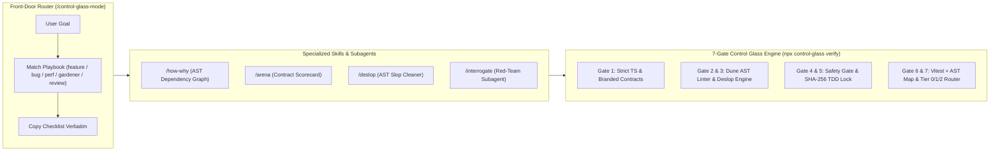

# 🔬 Control Glass v2.2 (`control-glass`)

> **Universal Multi-Vendor Agentic Engineering Plugin, MCP Server & CLI** — รองรับการทำงานกับ AI ทุกค่าย (**Anthropic Claude, OpenAI Codex/GPT, Google Gemini/Antigravity, Cursor, GitHub Copilot, Windsurf & Local Ollama**) เปลี่ยน AI Coding Agent จาก *"สายพานโรงงานที่ผลิตโค้ดขยะ (Slop Factory)"* สู่ **"ครัวมิชลิน (Michelin Kitchen)"** ที่ตรวจสอบด้วยหลักฐานเชิงประจักษ์ 7 ด่าน (7-Gate Empirical Verification)

---

## 🌐 รองรับ AI ทุกค่ายแบบ Universal (Multi-Vendor AI Support)

ไม่ว่าผู้พัฒนาจะใช้ AI ค่ายไหน `control-glass` สามารถเชื่อมต่อและบังคับใช้มาตรฐานเดียวกันทั้งหมดผ่าน 3 กลไก:

1. **🔄 Multi-Vendor Config & Slash-Command Sync (`npx control-glass sync-vendors`):**
   * **Claude Code (Anthropic):** สร้าง `CLAUDE.md` และคำสั่ง `.claude/commands/` (`/project:control-glass-mode`, `/project:interrogate`, `/project:deslop`, `/project:arena`)
   * **OpenAI Codex / Agents:** สร้างและซิงค์ `AGENTS.md`
   * **Cursor IDE:** สร้าง `.cursor/rules/control-glass.mdc` และ `plugin.json`
   * **GitHub Copilot:** สร้าง `.github/copilot-instructions.md`
   * **Windsurf:** สร้าง `.windsurfrules`
   * **Google Antigravity:** สร้าง `.agent/rules/`, `.agent/skills/` และ `plugin.json`
2. **🔌 Universal MCP Server (`npx control-glass mcp`):**
   * เปิดให้ Claude Desktop, Claude Code, OpenAI Agents SDK, Cursor หรือ IDE ใดๆ เรียกใช้ด่านตรวจของ `control-glass` (`control_glass_verify_gates`, `control_glass_deslop`, `control_glass_map_dependencies`, `control_glass_diff_tier`, `control_glass_lock_tests`, `control_glass_bench`) เป็น **Native MCP Tools** ได้ทันที
3. **🤖 Multi-Vendor LLM Gateway (`src/vendors/llm-gateway.ts`):**
   * โมดูล Type-safe สำหรับเชื่อมต่อ API ของ **Anthropic (`claude-3-7-sonnet`), OpenAI (`gpt-4o`), Google (`gemini-2.5-pro`), และ OpenAI-Compatible (`Ollama / DeepSeek / OpenRouter`)** เพื่อใช้ทำ Multi-Model `/arena` หรือ Cross-Vendor `/interrogate`

---

## ⚡ ทำไม `control-glass` v2.2 ถึงเหนือกว่า `pstack`? (Comparison Matrix)

แม้ `pstack` (`/poteto-mode`) จะวางโครงสร้าง Playbooks ที่ดีเยี่ยม แต่ `pstack` เป็นเพียง **ไฟล์ Markdown (Prompt-only / Level 3 Control)** ซึ่งหาก AI เผลอหลอนหรือแหกกฎ จะไม่มีโปรแกรมใดคอยบล็อกจริง

**`control-glass` v2.2** จึงผสาน **Multi-Skill Router ของ `pstack`** เข้ากับ **Executable TypeScript AST & Cryptographic Engine (Level 1 & 2 Control)**:

| ความสามารถ | `pstack` (`/poteto-mode`) | `control-glass` (`/control-glass-mode` v2.2) |
| :--- | :--- | :--- |
| **Front-Door Router & Playbooks** | `/poteto-mode` (Markdown) | **`/control-glass-mode`** (5 Playbooks: `feature`, `bug`, `perf`, `gardener`, `review`) |
| **Multi-Vendor AI Support** | รองรับเฉพาะ Cursor | **Universal:** รองรับ Claude Code, OpenAI Codex, Cursor, Copilot, Windsurf, Antigravity + **MCP Server** |
| **Code Comprehension (`/how`, `/why`)** | ให้ AI นั่งอ่านโค้ดสดทุกครั้ง (เปลือง Token) | **`/how-why` + `npx control-glass map`** สร้าง AST Dependency Graph (`.control-glass/dependency-graph.json`) แม่นยำ 100% |
| **Diff Hygiene (`/deslop`)** | สั่ง Prompt ให้ AI ช่วยดูโค้ดขยะ | **`/deslop` + `npx control-glass deslop --fix`** ใช้ TypeScript AST ลบคอมเมนต์อัตโนมัติ และดักจับ `catch {}` ว่าง, `debugger`, และฟังก์ชัน Wrapper ขยะ (`TRIVIAL_PASS_THROUGH_WRAPPER`) |
| **Boundary & Suppression Lock** | ❌ ไม่มี | **Dune AST Linter:** ดักจับทั้ง `import`, `export from`, `import()`, `require()` ข้าม Boundary และบล็อก `@ts-ignore` / `eslint-disable` (`DUNE_NO_LINTER_SUPPRESSION`) |
| **Design Competition (`/arena`)** | อภิปรายเปรียบเทียบด้วยทฤษฎี | **`/arena`** ให้คะแนน 0–100 ตามเกณฑ์ Continuum of Control (Branded Types, Boundary Isolation, Tier Impact) |
| **Adversarial Review (`/interrogate`)** | ถาม-ตอบทั่วไป | **`/interrogate` + `agents/interrogator.md`** ตรวจสอบกับ 4 กรณีศึกษาหายนะจริง (*Mars Orbiter, Knight Capital, Google Cloud, CrowdStrike*) |
| **Anti-Closed-Loop Testing** | ❌ ไม่มี (AI แก้เทสต์ตัวเองได้) | ✅ **Recursive SHA-256 TDD Lock (`tdd-guard.ts`)** ล็อกทั้ง `*.spec.ts`, `*.test.ts`, `*.contract.ts` ทุกโฟลเดอร์ย่อย |
| **Performance Hill-Climbing** | สั่งด้วย Prompt | ✅ **`npx control-glass bench`** วัด ops/sec และ V8 Heap Memory Delta จริง (พร้อม API `measureWorkload` สำหรับโปรเจกต์ผู้บริโภค) |
| **Zero-Bypass Enforcement** | ❌ ลืมเรียกสกิล = หลุดเข้า Git | ✅ **`npx control-glass install-hooks`** ฝัง Git `pre-commit` hook + GitHub Actions CI บล็อกอัตโนมัติ |

---

## 📖 คู่มือการใช้งานฉบับเต็ม (Documentation Guides)

* 📘 **[01 — Getting Started & Installation](./docs/guide/01-getting-started.md)**: วิธีติดตั้งเป็น Plugin และวิธีติดตั้ง CLI ลงในโปรเจกต์ของคุณ (`npx control-glass init`)
* 🧭 **[02 — Route Work Through `/control-glass-mode`](./docs/guide/02-control-glass-mode.md)**: วิธีใช้งาน `/control-glass-mode` ร่วมกับ `/arena`, `/interrogate`, `/deslop`, และ `/how-why`
* 🛡️ **[03 — Dune Architecture & Verification Gates](./docs/guide/03-dune-and-guardrails.md)**: เจาะลึก Branded Contracts, กฎ AST Linter, SHA-256 TDD Lock และการคัดแยก Tier 0 / Tier 1 / Tier 2
* 🌐 **[04 — Multi-Vendor AI Support (Claude, OpenAI, Gemini, Cursor, Copilot, MCP)](./docs/guide/04-multi-vendor-ai.md)**: วิธีเชื่อมต่อกับ AI ทุกค่ายและตั้งค่า MCP Server

---

## 🏗️ สถาปัตยกรรมและการทำงานของ `/control-glass-mode` v2.2 (7-Gate Pipeline)



### 🛡️ สรุป 7 ด่านตรวจสอบหลัก (`npx control-glass verify`)

1. **[Level 1] Strict TypeScript Compiler:** ตรวจสอบความถูกต้องของชนิดข้อมูลและ **Branded Types** (`NewtonSeconds`, `PoundForceSeconds`, `Satang`, `PercentageInt`)
2. **[Level 2] Dune AST Linter:** บังคับกฎไร้คอมเมนต์ (`DUNE_NO_COMMENTS`), ห้ามปิดคำเตือน (`DUNE_NO_LINTER_SUPPRESSION`), ล็อกขอบเขตการ Import ทั้งแบบ Static และ Dynamic (`DUNE_BOUNDARY_VIOLATION`), ห้ามใช้ `any` และห้ามใช้ `console.*` ในโดเมน
3. **[Level 2] AST Deslop Engine:** ตรวจจับ `catch {}` ว่างที่กลืน Error (`EMPTY_CATCH_BLOCK`), `debugger` ที่หลงเหลือ (`DEBUG_LEFTOVER`), และฟังก์ชัน Wrapper ขยะ (`TRIVIAL_PASS_THROUGH_WRAPPER`)
4. **[Phase 2] Safety & Secret Gate:** สแกนหา API Keys/Credentials รั่วไหล และบล็อกคำสั่งอันตราย (`DROP TABLE`, `TRUNCATE TABLE`, `rm -rf`, `eval`)
5. **[Phase 1] Recursive TDD & Contract Immutability Lock:** ตรวจสอบค่า SHA-256 ของไฟล์ `*.spec.ts`, `*.test.ts`, และ `*.contract.ts` ป้องกันไม่ให้ AI แอบแก้ข้อสอบตัวเอง
6. **[Level 1] Empirical Contract & Unit Tests:** รันชุดทดสอบทั้งหมดด้วย Vitest
7. **[Phase 3] AST Dependency Graph & Tiered Review Routing:** สร้าง `.control-glass/dependency-graph.json` และคำนวณระดับการรีวิว (`Tier 0` Auto-Merge / `Tier 1` Task Owner / `Tier 2` Senior Review) รองรับทั้ง Working Tree และ Git Commit History บน CI

---

## 🚀 วิธีนำไปติดตั้งในโปรเจกต์อื่น (How Other Developers Use This)

### วิธีที่ 1: ติดตั้งเป็น Plugin ใน AI IDE (Antigravity / Cursor / Claude)
```bash
git clone https://github.com/Sakeerin/control-glass.git ~/.gemini/config/plugins/control-glass
```
เมื่อติดตั้งแล้วสามารถเรียกใช้ **`/control-glass-mode`**, **`/arena`**, **`/interrogate`**, **`/deslop`**, และ **`/how-why`** ในแชตได้ทันที!

### วิธีที่ 2: ติดตั้งเป็น CLI & Package ในโปรเจกต์ TypeScript ของคุณ
```bash
# 1. ติดตั้งลงในโปรเจกต์ของคุณ (มีสคริปต์ prepack คอมไพล์ dist/ ให้อัตโนมัติ)
npm install --save-dev github:Sakeerin/control-glass

# 2. สร้างไฟล์ตั้งต้น (feature-map.json, AGENTS.md, CLAUDE.md, .cursor/rules, .control-glass/tdd-lock.json)
npx control-glass init

# 3. ติดตั้ง Git Pre-Commit Hook & GitHub Actions CI
npx control-glass install-hooks

# 4. รันตรวจสอบ 7 ด่าน
npx control-glass verify
```

สามารถ import Branded Contracts และตัววัดผล Benchmark ไปใช้ในโค้ดของโปรเจกต์คุณได้โดยตรง:
```typescript
import {
  type Brand,
  type Result,
  ok,
  err,
  measureWorkload
} from "control-glass";

export type OrderId = Brand<string, "OrderId">;
```

---

## 🛠️ คำสั่ง CLI ทั้งหมด (`npx control-glass <command>`)

| คำสั่ง CLI | คำสั่ง npm (ในโปรเจกต์นี้) | คำอธิบาย |
| :--- | :--- | :--- |
| `npx control-glass init` | `npm run cli -- init` | สร้าง `feature-map.json`, `AGENTS.md`, ซิงค์ไฟล์ทุก AI Vendor และสร้าง `.control-glass/tdd-lock.json` |
| `npx control-glass sync-vendors` | `npm run sync:vendors` | สร้างและอัปเดตไฟล์ตั้งค่าสำหรับ Claude (`CLAUDE.md`), OpenAI (`AGENTS.md`), Cursor, Copilot, Windsurf และ MCP |
| `npx control-glass mcp` | `npm run mcp` | รัน Model Context Protocol (MCP) Server ผ่าน stdio ให้ AI ทุกค่ายเรียกใช้ด่านตรวจเป็น Native Tools |
| `npx control-glass vendors` | `npm run cli -- vendors` | ตรวจสอบสถานะการตั้งค่า API ของ Anthropic Claude, OpenAI, Gemini และ Local Ollama |
| `npx control-glass verify` | `npm run verify` | **คำสั่งหลัก:** รันครบทั้ง 7 ด่านตรวจสอบ และสร้างไฟล์หลักฐาน `.control-glass/evidence-latest.json` |
| `npx control-glass map` | `npm run map` | สแกน AST สร้างแผนผัง Dependency & Exports (`.control-glass/dependency-graph.json`) |
| `npx control-glass deslop [--fix]` | `npm run deslop` | ตรวจจับและกวาดล้าง AI Slop (ลบคอมเมนต์อัตโนมัติ, ดักจับ `catch {}` ว่าง, `debugger`, และ Trivial Wrapper) |
| `npx control-glass bench` | `npm run bench` | รันทดสอบความเร็ว (ops/sec) และวัด V8 Memory Heap Delta (`.control-glass/bench-latest.json`) |
| `npx control-glass lint` | `npm run lint:dune` | รัน Dune AST Linter ตรวจจับ Comment, `@ts-ignore`, การแหกกฎ Boundary Import, และการใช้ `any` |
| `npx control-glass safety` | `npm run guard:safety` | สแกนหา API Keys/Secrets รั่วไหล และคำสั่งอันตรายในโค้ด |
| `npx control-glass tdd-check` | `npm run guard:tdd` | ตรวจสอบว่าไฟล์ Test และ Contract ไม่ถูกแอบแก้ไขระหว่างที่ AI เขียนโค้ด |
| `npx control-glass lock` | `npm run lock:tests` | อัปเดตค่า SHA-256 Lock ใน `.control-glass/tdd-lock.json` *(ใช้ใน Phase 1 ตอนล็อกสเปก)* |
| `npx control-glass diff` | `npm run review:diff` | วิเคราะห์ไฟล์ที่เปลี่ยนแปลงใน Git เทียบกับ `feature-map.json` เพื่อจัดระดับ `Tier 0 / 1 / 2` |
| `npx control-glass install-hooks` | `npm run install:hooks` | ติดตั้ง Git `pre-commit` hook และสร้างไฟล์ `.github/workflows/control-glass.yml` |

---

## 📂 โครงสร้างปลั๊กอินและแพ็กเกจ (Plugin & Package Structure)

```text
control-glass/
├── plugin.json                      # Plugin Manifest v2.2
├── mcp_config.json                  # การตั้งค่า MCP Server มาตรฐาน
├── AGENTS.md                        # สัญญาหลักสำหรับ OpenAI Codex / Universal Agents
├── CLAUDE.md                        # สัญญาหลักสำหรับ Anthropic Claude Code
├── .claude/commands/                # Slash Commands สำหรับ Claude Code
├── .cursor/rules/control-glass.mdc  # กฎอัตโนมัติสำหรับ Cursor IDE
├── .github/copilot-instructions.md  # กฎอัตโนมัติสำหรับ GitHub Copilot
├── .windsurfrules                   # กฎอัตโนมัติสำหรับ Windsurf
├── agents/
│   └── interrogator.md              # 🕵️‍♂️ Red-Team Adversarial Reviewer Subagent
├── skills/                          # ชุดทักษะของปลั๊กอิน
│   ├── control-glass-mode/          # 🧭 Main Router Skill (5 Playbooks: feature, bug, perf, gardener, review)
│   ├── how-why/                     # 🗺️ AST Dependency Graph & Git Intent Comprehension
│   ├── arena/                       # 🏛️ Contract-Driven Architecture Competition (100-pt Scorecard)
│   ├── deslop/                      # 🧹 Deterministic AST Slop Cleaner
│   ├── interrogate/                 # 🕵️‍♂️ 4-Disaster Adversarial Audit
│   ├── setup-control-glass/         # ⚙️ ทักษะตั้งค่าระบบลงโปรเจกต์ใหม่
│   ├── pac-tdd-workflow/            # 🔒 ทักษะออกแบบ Contract & ล็อก TDD
│   ├── control-glass-verify/        # 🔬 ทักษะรันเก็บหลักฐานเชิงประจักษ์
│   ├── dune-gardener/               # 🌱 ทักษะกำจัด Tech Debt และเขียนกฎ AST Linter
│   └── diff-consequence-reviewer/   # 🚦 ทักษะวิเคราะห์ผลกระทบและคัดกรอง Tier 0/1/2
├── docs/guide/                      # คู่มือการใช้งานฉบับสมบูรณ์ (01 - 04)
├── src/
│   ├── index.ts                     # Library Entrypoint
│   ├── core/contracts.ts            # Branded Types & Result Monad
│   ├── vendors/llm-gateway.ts       # Multi-Vendor LLM Payload Adapter (Claude, OpenAI, Gemini, Ollama)
│   ├── harness/                     # Executable 7-Gate Engine & MCP Server
│   ├── features/                    # ตัวอย่างโดเมนฟีเจอร์ (Thruster, Ledger, Canary Rollout)
│   └── ui/                          # ตัวอย่างชั้นแสดงผล (Renderer-safe Tier 0)
├── tests/                           # ชุดทดสอบระบบที่ถูกล็อกด้วย SHA-256
└── LICENSE                          # MIT License
```

---

## 📄 สัญญาอนุญาต (License)
เผยแพร่ภายใต้สัญญาอนุญาต **[MIT License](./LICENSE)**
