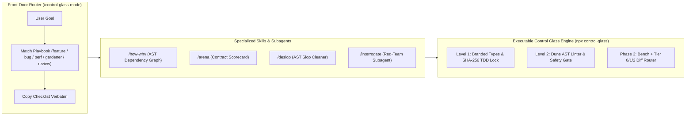

# 🔬 Control Glass v2.0 (`control-glass`)

> **High-Trust Agentic Engineering Plugin & CLI** — เปลี่ยน AI Coding Agent จาก *"สายพานโรงงานที่ผลิตโค้ดขยะ (Slop Factory)"* สู่ **"ครัวมิชลิน (Michelin Kitchen)"** ที่นำทางด้วย `/control-glass-mode` พร้อมเครื่องมือตรวจสอบระดับ AST, SHA-256 TDD Lock, V8 Heap Benchmark และการคัดกรอง Tiered Review อัตโนมัติ

---

## ⚡ ทำไม `control-glass` ถึงเหนือกว่า `pstack`? (Comparison Matrix)

แม้ `pstack` (`/poteto-mode`) จะวางโครงสร้าง Playbooks ที่ดีเยี่ยม แต่ `pstack` เป็นเพียง **ไฟล์ Markdown (Prompt-only / Level 3 Control)** ซึ่งหาก AI เผลอหลอนหรือแหกกฎ จะไม่มีโปรแกรมใดคอยบล็อกจริง

**`control-glass` v2.0** จึงผสาน **Multi-Skill Router ของ `pstack`** เข้ากับ **Executable TypeScript AST & Cryptographic Engine (Level 1 & 2 Control)**:

| ความสามารถ | `pstack` (`/poteto-mode`) | `control-glass` (`/control-glass-mode` v2.0) |
| :--- | :--- | :--- |
| **Front-Door Router & Playbooks** | `/poteto-mode` (Markdown) | **`/control-glass-mode`** (5 Playbooks: `feature`, `bug`, `perf`, `gardener`, `review`) |
| **Code Comprehension (`/how`, `/why`)** | ให้ AI นั่งอ่านโค้ดสดทุกครั้ง (เปลือง Token) | **`/how-why` + `npx control-glass map`** สร้าง AST Dependency Graph (`.control-glass/dependency-graph.json`) แม่นยำ 100% |
| **Diff Hygiene (`/deslop`)** | สั่ง Prompt ให้ AI ช่วยดูโค้ดขยะ | **`/deslop` + `npx control-glass deslop --fix`** ใช้ TypeScript Scanner ลบคอมเมนต์อัตโนมัติ และดักจับ `catch {}` ว่าง / `debugger` |
| **Design Competition (`/arena`)** | อภิปรายเปรียบเทียบด้วยทฤษฎี | **`/arena`** ให้คะแนน 0–100 ตามเกณฑ์ Continuum of Control (Branded Types, Boundary Isolation, Tier Impact) |
| **Adversarial Review (`/interrogate`)** | ถาม-ตอบทั่วไป | **`/interrogate` + `agents/interrogator.md`** ตรวจสอบกับ 4 กรณีศึกษาหายนะจริง (*Mars Orbiter, Knight Capital, Google Cloud, CrowdStrike*) |
| **Anti-Closed-Loop Testing** | ❌ ไม่มี (AI แก้เทสต์ตัวเองได้) | ✅ **SHA-256 TDD Lock (`tdd-guard.ts`)** บล็อกทันทีถ้า AI แอบแก้ไฟล์เทสต์ |
| **Performance Hill-Climbing** | สั่งด้วย Prompt | ✅ **`npx control-glass bench`** วัด ops/sec และ V8 Heap Memory Delta จริง |
| **Zero-Bypass Enforcement** | ❌ ลืมเรียกสกิล = หลุดเข้า Git | ✅ **`npx control-glass install-hooks`** ฝัง Git `pre-commit` hook + GitHub Actions CI บล็อกอัตโนมัติ |

---

## 📖 คู่มือการใช้งานฉบับเต็ม (Documentation Guides)

* 📘 **[01 — Getting Started & Installation](./docs/guide/01-getting-started.md)**: วิธีติดตั้งเป็น Plugin และวิธีติดตั้ง CLI ลงในโปรเจกต์ของคุณ (`npx control-glass init`)
* 🧭 **[02 — Route Work Through `/control-glass-mode`](./docs/guide/02-control-glass-mode.md)**: วิธีใช้งาน `/control-glass-mode` ร่วมกับ `/arena`, `/interrogate`, `/deslop`, และ `/how-why`
* 🛡️ **[03 — Dune Architecture & The 6 Verification Gates](./docs/guide/03-dune-and-guardrails.md)**: เจาะลึก Branded Contracts, กฎ AST Linter, SHA-256 TDD Lock และการคัดแยก Tier 0 / Tier 1 / Tier 2

---

## 🏗️ สถาปัตยกรรมและการทำงานของ `/control-glass-mode` v2.0



---

## 🚀 วิธีนำไปติดตั้งในโปรเจกต์อื่น (How Other Developers Use This)

### วิธีที่ 1: ติดตั้งเป็น Plugin ใน AI IDE (Antigravity / Cursor)
```bash
git clone https://github.com/Sakeerin/control-glass.git ~/.gemini/config/plugins/control-glass
```
เมื่อติดตั้งแล้วสามารถเรียกใช้ **`/control-glass-mode`**, **`/arena`**, **`/interrogate`**, **`/deslop`**, และ **`/how-why`** ในแชตได้ทันที!

### วิธีที่ 2: ติดตั้งเป็น CLI & Package ในโปรเจกต์ TypeScript ของคุณ
```bash
# 1. ติดตั้งลงในโปรเจกต์ของคุณ
npm install --save-dev github:Sakeerin/control-glass

# 2. สร้างไฟล์ตั้งต้น (feature-map.json, AGENTS.md, .control-glass/tdd-lock.json)
npx control-glass init

# 3. ติดตั้ง Git Pre-Commit Hook & GitHub Actions CI
npx control-glass install-hooks

# 4. รันตรวจสอบ 6 ด่าน
npx control-glass verify
```

---

## 🛠️ คำสั่ง CLI ทั้งหมด (`npx control-glass <command>`)

| คำสั่ง CLI | คำสั่ง npm (ในโปรเจกต์นี้) | คำอธิบาย |
| :--- | :--- | :--- |
| `npx control-glass init` | `npm run cli -- init` | สร้าง `feature-map.json`, `AGENTS.md`, และ `.control-glass/tdd-lock.json` ในโปรเจกต์ปลายทาง |
| `npx control-glass verify` | `npm run verify` | **คำสั่งหลัก:** รันทุกด่านตรวจสอบพร้อมกัน และสร้างไฟล์หลักฐาน `.control-glass/evidence-latest.json` |
| `npx control-glass map` | `npm run map` | สแกน AST สร้างแผนผัง Dependency & Exports (`.control-glass/dependency-graph.json`) |
| `npx control-glass deslop [--fix]` | `npm run deslop` | ตรวจจับและกวาดล้าง AI Slop (ลบคอมเมนต์อัตโนมัติ, ดักจับ `catch {}` ว่าง และ `debugger`) |
| `npx control-glass bench` | `npm run bench` | รันทดสอบความเร็ว (ops/sec) และวัด V8 Memory Heap Delta (`.control-glass/bench-latest.json`) |
| `npx control-glass lint` | `npm run lint:dune` | รัน Dune AST Linter ตรวจจับ Comment, การแหกกฎ Boundary Import, และการใช้ `any` |
| `npx control-glass safety` | `npm run guard:safety` | สแกนหา API Keys/Secrets รั่วไหล และคำสั่งอันตรายในโค้ด |
| `npx control-glass tdd-check` | `npm run guard:tdd` | ตรวจสอบว่าไฟล์ Test และ Contract ไม่ถูกแอบแก้ไขระหว่างที่ AI เขียนโค้ด |
| `npx control-glass lock` | `npm run lock:tests` | อัปเดตค่า SHA-256 Lock ใน `.control-glass/tdd-lock.json` *(ใช้ใน Phase 1 ตอนล็อกสเปก)* |
| `npx control-glass diff` | `npm run review:diff` | วิเคราะห์ไฟล์ที่เปลี่ยนแปลงใน Git เทียบกับ `feature-map.json` เพื่อจัดระดับ `Tier 0 / 1 / 2` |
| `npx control-glass install-hooks` | `npm run install:hooks` | ติดตั้ง Git `pre-commit` hook และสร้างไฟล์ `.github/workflows/control-glass.yml` |

---

## 📂 โครงสร้างปลั๊กอินและแพ็กเกจ (Plugin & Package Structure)

```text
control-glass/
├── plugin.json                      # Plugin Manifest v2.0
├── assets/logo.svg                  # ไอคอนประจำปลั๊กอิน
├── rules/AGENTS.md                  # Sticky Rules ของปลั๊กอิน
├── agents/
│   └── interrogator.md              # 🕵️‍♂️ Red-Team Adversarial Reviewer Subagent
├── skills/                          # ชุดทักษะของปลั๊กอิน (เหนือกว่า pstack)
│   ├── control-glass-mode/          # 🧭 Main Router Skill (5 Playbooks: feature, bug, perf, gardener, review)
│   ├── how-why/                     # 🗺️ AST Dependency Graph & Git Intent Comprehension
│   ├── arena/                       # 🏛️ Contract-Driven Architecture Competition (100-pt Scorecard)
│   ├── deslop/                      # 🧹 Deterministic AST Slop Cleaner
│   ├── interrogate/                 # 🕵️‍♂️ 4-Disaster Adversarial Audit
│   ├── setup-control-glass/         # ⚙️ ทักษะตั้งค่าระบบลงโปรเจกต์ใหม่
│   ├── pac-tdd-workflow/            # 🔒 ทักษะออกแบบ Contract & ล็อก TDD
│   ├── control-glass-verify/        # 🔬 ทักษะรันเก็บหลักฐานเชิงประจักษ์
│   ├── dune-gardener/               # 🌱 ทักษะกำจัด Tech Debt และเขียนกฎ AST Linter
│   └── diff-consequence-reviewer/   # 🚦 ทักษะวิเคราะห์ผลกระทบและคัดกรอง Tier 0/1/2
├── docs/guide/                      # คู่มือการใช้งาน
│   ├── 01-getting-started.md
│   ├── 02-control-glass-mode.md
│   └── 03-dune-and-guardrails.md
├── src/
│   ├── index.ts                     # Library Entrypoint
│   ├── core/contracts.ts            # Branded Types & Result Monad
│   ├── harness/                     # Executable Engine
│   │   ├── cli.ts                   # CLI Dispatcher (`npx control-glass`)
│   │   ├── control-glass.ts         # 6-Gate Verification Runner
│   │   ├── auto-mapper.ts           # AST Dependency & Export Graph Builder
│   │   ├── deslop.ts                # AST Slop Detector & Auto-Comment Stripper
│   │   ├── bench.ts                 # Runtime & V8 Heap Hill-Climber
│   │   ├── hook-installer.ts        # Git Pre-Commit & GitHub Actions CI Generator
│   │   ├── dune-linter.ts           # TypeScript AST Linter
│   │   ├── tdd-guard.ts             # SHA-256 TDD Immutability Lock
│   │   ├── safety-gate.ts           # Secret & Destructive Command Scanner
│   │   └── diff-reviewer.ts         # Tier 0 / 1 / 2 Diff Orchestrator
│   ├── features/                    # ตัวอย่างโดเมนฟีเจอร์ (Thruster, Ledger, Canary Rollout)
│   └── ui/                          # ตัวอย่างชั้นแสดงผล (Renderer-safe Tier 0)
└── tests/                           # ชุดทดสอบระบบที่ถูกล็อกด้วย SHA-256
```
