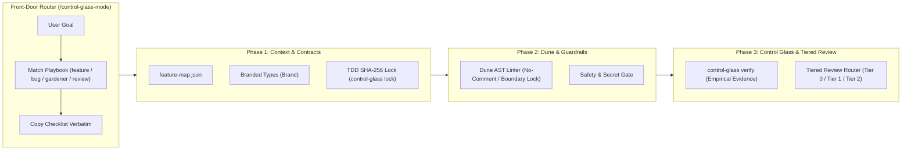

# 🔬 Control Glass (`control-glass`)

> **High-Trust Agentic Engineering Plugin & CLI** — เปลี่ยน AI Coding Agent จาก *"สายพานโรงงานที่ผลิตโค้ดขยะ (Slop Factory)"* สู่ **"ครัวมิชลิน (Michelin Kitchen)"** ที่นำทางด้วย `/control-glass-mode` (สไตล์ `pstack` `/poteto-mode`), ตรวจสอบด้วยหลักฐานเชิงประจักษ์ 6 ด่าน และทลายคอขวดการตรวจโค้ด (Code Review Bottleneck) อย่างเป็นระบบ

---

## 🌟 2 รูปแบบการนำไปใช้งาน (Dual Distribution)

โปรเจกต์นี้ออกแบบมาให้ผู้พัฒนาคนอื่นๆ นำไปติดตั้งในโปรเจกต์ของตัวเองได้ทันทีทั้ง 2 รูปแบบ:

1. **🔌 AI Agent Plugin (`plugin.json` + `/control-glass-mode`):**
   * โครงสร้างเดียวกับ `cursor/plugins/pstack` มี Front-Door Router Skill ชื่อ **`/control-glass-mode`** ที่คอยจับคู่โจทย์เข้ากับ Playbooks (`feature.md`, `bug.md`, `gardener.md`, `review.md`) และคัดลอก Checklist ออกมาทำทีละขั้นโดยไม่ข้ามขั้นตอน
2. **📦 Executable CLI & TypeScript Library (`npx control-glass`):**
   * ติดตั้งผ่าน npm/GitHub ลงในโปรเจกต์ใดก็ได้ เพื่อรันคำสั่ง `npx control-glass init`, `npx control-glass verify`, `npx control-glass lock`, `npx control-glass lint`, และ `npx control-glass diff` พร้อม import Branded Types (`Brand`, `Result`, `ok`, `err`) ไปใช้งานได้ทันที

---

## 📖 คู่มือการใช้งานฉบับเต็ม (Documentation Guides)

* 📘 **[01 — Getting Started & Installation](./docs/guide/01-getting-started.md)**: วิธีติดตั้งเป็น Plugin และวิธีติดตั้ง CLI ลงในโปรเจกต์ของคุณ (`npx control-glass init`)
* 🧭 **[02 — Route Work Through `/control-glass-mode`](./docs/guide/02-control-glass-mode.md)**: วิธีใช้งาน `/control-glass-mode` เป็นประตูหน้าด่าน (Router Pattern) เพื่อสั่งงาน AI Agent อย่างมีวินัย (แบบเดียวกับ `02-poteto-mode.md`)
* 🛡️ **[03 — Dune Architecture & The 6 Verification Gates](./docs/guide/03-dune-and-guardrails.md)**: เจาะลึก Branded Contracts, กฎ AST Linter, SHA-256 TDD Lock และการคัดแยก Tier 0 / Tier 1 / Tier 2

---

## 🎯 ทำไมต้องมี Control Glass? (The Problem We Solve)

เมื่อทีมพัฒนาใช้ AI Agent ช่วยเขียนโค้ด ความเร็วในการสร้างโค้ดจะเพิ่มขึ้นอย่างก้าวกระโดด แต่สิ่งที่เกิดขึ้นตามมาคือ:
1. **Babysitting Trap (กับดักการนั่งเฝ้า AI):** หากปล่อยให้ AI ทำงานโดยไม่มีกรอบควบคุม AI มักจะใช้ทางลัด แปะผ้าปิดแผล (Workarounds) และคัดลอกรูปแบบโค้ดแย่ๆ ไปทั่วโปรเจกต์
2. **Review Overload (คอขวดย้ายไปที่การตรวจโค้ด):** งานเขียนโค้ดเสร็จเร็วขึ้น แต่เวลารอตรวจ Pull Request (Code Review) กลับช้าลงกว่า **400%** และเกิดบั๊กหลุดเข้า Production เพิ่มขึ้น **2–3 เท่า**
3. **Closed-Loop Testing Error (AI โกงข้อสอบตัวเอง):** หากสั่งให้ AI เขียนทั้งโค้ดและ Unit Test พร้อมกัน AI มักจะแอบแก้ Test ให้ผ่านตามโค้ดที่ผิดของตัวเอง

---

## 🏗️ สถาปัตยกรรมและการทำงานของ `/control-glass-mode`



---

## 🚀 วิธีนำไปติดตั้งในโปรเจกต์อื่น (How Other Developers Use This)

### วิธีที่ 1: ติดตั้งเป็น Plugin ใน AI IDE (Antigravity / Cursor)
```bash
git clone https://github.com/Sakeerin/control-glass.git ~/.gemini/config/plugins/control-glass
```
เมื่อติดตั้งแล้วสามารถเรียกใช้ **`/control-glass-mode`** ในแชตเพื่อนำทางทุกงานวิศวกรรมซอฟต์แวร์ได้ทันที!

### วิธีที่ 2: ติดตั้งเป็น CLI & Package ในโปรเจกต์ TypeScript ของคุณ
```bash
# 1. ติดตั้งลงในโปรเจกต์ของคุณ
npm install --save-dev github:Sakeerin/control-glass

# 2. สร้างไฟล์ตั้งต้น (feature-map.json, AGENTS.md, .control-glass/tdd-lock.json)
npx control-glass init

# 3. รันตรวจสอบ 6 ด่าน
npx control-glass verify
```

สามารถ import Branded Contracts ไปใช้ในโค้ดของโปรเจกต์คุณได้โดยตรง:
```typescript
import { type Brand, type Result, ok, err } from "control-glass";

export type OrderId = Brand<string, "OrderId">;
```

---

## 🛠️ คำสั่ง CLI ทั้งหมด (`npx control-glass <command>`)

| คำสั่ง CLI | คำสั่ง npm (ในโปรเจกต์นี้) | คำอธิบาย |
| :--- | :--- | :--- |
| `npx control-glass init` | `npm run cli -- init` | สร้าง `feature-map.json`, `AGENTS.md`, และ `.control-glass/tdd-lock.json` ในโปรเจกต์ปลายทาง |
| `npx control-glass verify` | `npm run verify` | **คำสั่งหลัก:** รันทุกด่านตรวจสอบพร้อมกัน และสร้างไฟล์หลักฐาน `.control-glass/evidence-latest.json` |
| `npx control-glass lint` | `npm run lint:dune` | รัน Dune AST Linter ตรวจจับ Comment, การแหกกฎ Boundary Import, และการใช้ `any` |
| `npx control-glass safety` | `npm run guard:safety` | สแกนหา API Keys/Secrets รั่วไหล และคำสั่งอันตรายในโค้ด |
| `npx control-glass tdd-check` | `npm run guard:tdd` | ตรวจสอบว่าไฟล์ Test และ Contract ไม่ถูกแอบแก้ไขระหว่างที่ AI เขียนโค้ด |
| `npx control-glass lock` | `npm run lock:tests` | อัปเดตค่า SHA-256 Lock ใน `.control-glass/tdd-lock.json` *(ใช้ใน Phase 1 ตอนล็อกสเปก)* |
| `npx control-glass diff` | `npm run review:diff` | วิเคราะห์ไฟล์ที่เปลี่ยนแปลงใน Git เทียบกับ `feature-map.json` เพื่อจัดระดับ `Tier 0 / 1 / 2` |

---

## 📂 โครงสร้างปลั๊กอินและแพ็กเกจ (Plugin & Package Structure)

```text
control-glass/
├── plugin.json                      # Plugin Manifest (สำหรับติดตั้งเป็น AI Plugin)
├── assets/logo.svg                  # ไอคอนประจำปลั๊กอิน
├── rules/AGENTS.md                  # กฎหลักของปลั๊กอินที่ทำงานอัตโนมัติเมื่อเปิดใช้
├── skills/                          # ชุดทักษะของปลั๊กอิน (เหมือน pstack/skills/)
│   ├── control-glass-mode/          # 🧭 Main Router Skill (เทียบเท่า /poteto-mode)
│   │   ├── SKILL.md
│   │   └── playbooks/               # ขั้นตอนการทำงานมาตรฐาน (feature, bug, gardener, review)
│   ├── setup-control-glass/         # ทักษะติดตั้งระบบลงโปรเจกต์ใหม่
│   ├── pac-tdd-workflow/            # ทักษะออกแบบ Contract & ล็อก TDD
│   ├── control-glass-verify/        # ทักษะรันเก็บหลักฐานเชิงประจักษ์
│   ├── dune-gardener/               # ทักษะกำจัด Tech Debt และเขียนกฎ AST Linter
│   └── diff-consequence-reviewer/   # ทักษะวิเคราะห์ผลกระทบและคัดกรอง Tier 0/1/2
├── docs/guide/                      # คู่มือการใช้งานสไตล์ pstack
│   ├── 01-getting-started.md
│   ├── 02-control-glass-mode.md
│   └── 03-dune-and-guardrails.md
├── src/
│   ├── index.ts                     # Library Entrypoint สำหรับ import ไปใช้ในโปรเจกต์อื่น
│   ├── core/contracts.ts            # Branded Types & Result Monad
│   ├── harness/
│   │   ├── cli.ts                   # Executable CLI (`npx control-glass`)
│   │   ├── control-glass.ts         # 6-Gate Verification Runner
│   │   ├── dune-linter.ts           # TypeScript AST Linter
│   │   ├── tdd-guard.ts             # SHA-256 TDD Immutability Lock
│   │   ├── safety-gate.ts           # Secret & Destructive Command Scanner
│   │   └── diff-reviewer.ts         # Tier 0 / 1 / 2 Diff Orchestrator
│   ├── features/                    # ตัวอย่างโดเมนฟีเจอร์ (Thruster, Ledger, Canary Rollout)
│   └── ui/                          # ตัวอย่างชั้นแสดงผล (Renderer-safe Tier 0)
└── tests/                           # ชุดทดสอบระบบที่ถูกล็อกด้วย SHA-256
```

---

## 📚 เอกสารแนวคิดต้นฉบับ
* [document.md](./document.md) — บทสรุปแนวคิด *"Michelin Kitchen"* และ 4 เสาหลักในการควบคุมกองทัพ AI Agent (Grokbot / Dune / Control Glass / PAC)
* [document2.md](./document2.md) — บทสรุปแนวคิด *"The Bottleneck Moved"* และกรอบการแก้ปัญหาคอขวด 3 ระยะ (Context, Guardrails, Orchestration)
