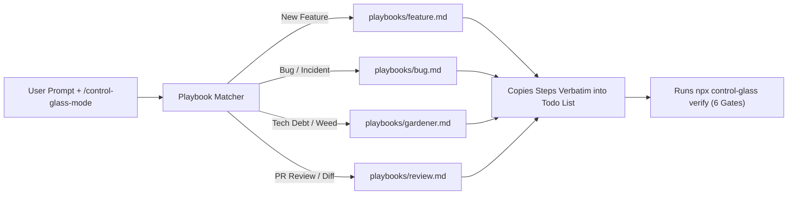

# 02 — Route Work Through `/control-glass-mode`

> Inspired by `pstack`'s `/poteto-mode`, **`/control-glass-mode`** is the primary front door for engineering tasks. Instead of micromanaging individual skills or reminding the agent not to write sloppy code, route your prompt through `/control-glass-mode`.

---

## How the Router Pattern Works

When you give `/control-glass-mode` a goal:

1. **Matches the Right Playbook:** It classifies your request into Feature Development (`feature.md`), Bug Fixing (`bug.md`), Tech Debt Gardening (`gardener.md`), or PR Diff Review (`review.md`).
2. **Copies Steps Verbatim:** Before touching a single line of code, the agent copies the playbook's checklist verbatim into its plan. This prevents the agent from skipping `feature-map.json` lookup or bypassing the **Phase 1 TDD SHA-256 Lock**.
3. **Orchestrates Companion Skills:** As it works through the checklist, it invokes `pac-tdd-workflow`, `dune-gardener`, `diff-consequence-reviewer`, and `control-glass-verify`.
4. **Proves It Empirically:** The task cannot finish until `npx control-glass verify` passes all 6 gates and writes `.control-glass/evidence-latest.json`.

---

## Prompting Discipline (Examples)

State **what** you want to achieve and **how to verify it**, then let `/control-glass-mode` handle the workflow:

### Example 1: Building a New Feature
> `/control-glass-mode` Add a rate-limit token bucket calculator in `src/features/ratelimit/`. Use Branded Types for `TokensPerSecond` and `BurstCapacity`. Reject negative rates and lock the unit tests before implementing.

**What the agent will do automatically:**
1. Read `feature-map.json`.
2. Add `TokensPerSecond` and `BurstCapacity` to `src/core/contracts.ts`.
3. Write `tests/ratelimit.spec.ts` and run `npx control-glass lock` to freeze the SHA-256 hash.
4. Implement the feature with zero comments and zero `any`.
5. Run `npx control-glass verify` and report the Review Tier.

### Example 2: Fixing a Bug Without Band-Aids
> `/control-glass-mode` Fix the rounding bug when converting imperial impulse in `impulse-calculator.ts`. Reproduce with a locked test first.

### Example 3: Running as a Dune Gardener ("Stop the Bleeding")
> `/control-glass-mode` We noticed agents using `Date.now()` directly in domain logic instead of passing a branded `EpochMillis` timestamp. Clean this up and add a Dune AST lint rule so it never happens again.

---

## Keeping `/control-glass-mode` Sticky Across Turns

Because `rules/AGENTS.md` is bundled at the plugin root (and `.agent/rules/michelin-kitchen-protocol.md` in workspace mode), the core engineering axioms remain active across every turn of your conversation—ensuring the agent never regresses into writing band-aid comments or mutating locked tests on follow-up turns.
